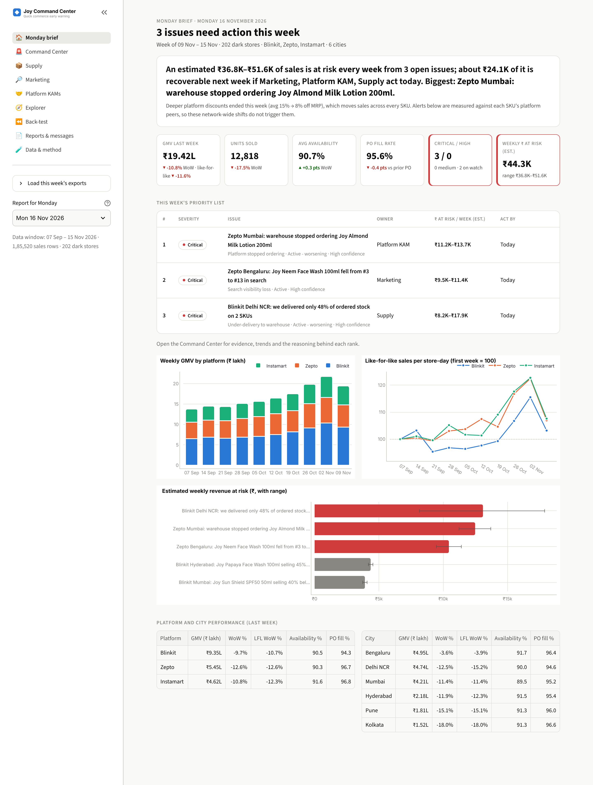

# Joy Command Center

[](https://github.com/Devyansh-Choudhary/rsh-global-assignment/actions/workflows/tests.yml)

**A quick-commerce early-warning system for Joy's Monday morning.** It turns the weekly Blinkit, Zepto and Instamart
exports into a short, ranked list of problems, says who owns each one, puts a rupee estimate on it, and produces the
PDF, CSV and WhatsApp messages to send to Supply, Marketing and the platform KAMs.

```bash
pip install -r requirements.txt
streamlit run app.py                        # the app (opens on Monday 16 Nov 2026)
python scripts/generate_reports.py          # PDF + CSV + WhatsApp text into outputs/
python -m pytest -q                         # 44 tests
```



**Deliverables for Monday 16 Nov:**
- [78-second demo video](outputs/demo_walkthrough.mp4)
- [PDF report](outputs/joy_monday_report_2026-11-16.pdf)
- [CSV action list](outputs/action_list_2026-11-16.csv)
- [WhatsApp messages](outputs/whatsapp_messages_2026-11-16.txt)
- [screenshots of every page](outputs/screenshots/)
- [submission note](SUBMISSION_NOTE.md)
- [data audit and incident investigation](docs/ANALYSIS.md)

---

## 1. Problem

Every Monday the Quick Commerce Manager downloads ~20,000 rows of sales and stock data, spends half a day in pivot tables,
and messages the teams that need to act. Three problems in the last two months were caught 3–5 weeks late:

| # | Incident | Owner | Noticed after |
|---|---|---|---|
| 1 | Blinkit Bengaluru: Joy delivered ~half of what the warehouse ordered on six SKUs, so dark stores ran out | Supply | ~5 weeks |
| 2 | Zepto Bengaluru: best-selling face wash fell from ~#3 to ~#13 in search, with healthy stock | Marketing | ~1 month |
| 3 | Instamart Hyderabad: warehouse stopped ordering sunscreen for two weeks, so stores ran out | Instamart KAM | ~3 weeks |

The goal is to catch problems like these **in the first week**, without flagging every small dip.

## 2. What it does: results on the supplied data

**Monday 16 November 2026: three issues need action.** #1 and #3 are new problems the brief does not mention; #2 is brief incident #2, still unresolved five weeks on.

| # | Severity | Issue | Owner | Est. ₹ at risk / week |
|---|---|---|---|---|
| 1 | Critical | **Zepto Mumbai: warehouse stopped ordering Almond Milk Lotion 200ml.** No PO for 2 cycles; availability fell 91% → 0% in the last 3 days, 12/12 stores out | Zepto KAM | ₹11.2K–₹13.7K |
| 2 | Critical | **Zepto Bengaluru: Neem Face Wash 100ml #3 → #13 in search since Wed 14 Oct.** Still ongoing; availability normal (90%); sales −60% vs platform | Marketing | ₹9.5K–₹11.4K |
| 3 | Critical | **Blinkit Delhi NCR: only 48% of the 9 Nov PO delivered** for Night Repair Cream 50ml and Almond Milk Lotion 400ml; 18/22 stores now below 50% availability | Supply | ₹8.2K–₹17.9K |

Two single-week sales dips sit on a **watchlist** (low confidence, not sent as actions). The two supply-side historical
incidents (#1 and #3 in the brief) are shown as **resolved**, with estimated lost sales of ₹2.45L–₹3.35L and ₹8.5K–₹10.7K.

**Back-test.** The engine was replayed for every Monday from 21 Sep, using only the data available that morning.

| Incident | Started | First flagged | Delay |
|---|---|---|---|
| Instamart Hyderabad sunscreen PO stop (brief #3) | w/c 14 Sep | Mon 21 Sep | first possible Monday |
| Blinkit Bengaluru under-delivery, 6 SKUs (brief #1) | w/c 21 Sep | Mon 28 Sep | first possible Monday |
| Zepto Bengaluru face-wash rank drop (brief #2) | w/c 12 Oct | Mon 19 Oct | first possible Monday |
| Zepto Mumbai lotion PO stop (new) | w/c 2 Nov | Mon 9 Nov | first possible Monday |
| Blinkit Delhi NCR under-delivery (new) | w/c 9 Nov | Mon 16 Nov | first possible Monday |

At most **three** items reached the priority list on any Monday, so the list stays short enough to read.

## 3. Features

| Page | What it is for |
|---|---|
| **Monday brief** | 30-second summary: headline risk, KPIs (GMV, like-for-like, units, availability, fill rate, alerts, ₹ at risk), priority list, platform/city performance |
| **Command Center** | Ranked incident cards with filters (platform, city, product, severity, owner, status). Each card expands to evidence, trend charts, revenue maths, and a score breakdown that explains the rank |
| **Supply** | Fill-rate heatmap (warehouse × PO week), warehouse × SKU scorecard, ship-now quantities, ordered-vs-delivered drill-down |
| **Marketing** | Visibility issues kept separate from stock issues, rank-vs-baseline watch table, rank heatmap by city, and a "pause ads" list for out-of-stock SKUs |
| **Platform KAMs** | Ordering stoppages, PO-compliance heatmap, missed-PO log, listing checks, platform scorecard |
| **Explorer** | Drill down by platform, city, product, warehouse and dark store, from weekly trends to daily availability |
| **Back-test** | Replays every past Monday to show when each incident would have been caught |
| **Reports & messages** | One-click PDF, CSV action list, all-incidents CSV, and WhatsApp messages per team with copy buttons. Nothing is sent automatically |
| **Data & method** | Cleaning log, row reconciliation, quarantine, thresholds, methodology, limitations |

The sidebar **"Report for Monday"** selector replays any past Monday. You can also **upload four new CSVs** to run the tool on next week's exports.

## 4. Architecture

```
joy-command-center/
├── app.py                    Entry point: page setup, sidebar (data source, report Monday), navigation
├── views/                    One module per app page (brief, command_center, supply, marketing, …)
├── config.py                 Every threshold, weight and assumption, each with its justification
├── src/
│   ├── data_loader.py        Reads CSVs as text; schema check
│   ├── data_cleaning.py      Validation, normalisation, de-duplication, quarantine, audit log
│   ├── feature_engineering.py Weekly tables (store×SKU, warehouse×SKU, PO grid), as-of filtering
│   ├── supply_analysis.py    Fill-rate shortfall detector + scorecards
│   ├── po_analysis.py        PO-inactivity detector
│   ├── availability_analysis.py  Availability-drop detector
│   ├── search_analysis.py    Search-rank detector
│   ├── sales_analysis.py     Peer-normalised, significance-tested sales detector
│   ├── revenue_impact.py     Observed / lost-to-date / at-risk / recoverable estimates
│   ├── prioritisation.py     Root-cause linking, grouping, scoring, narratives
│   ├── engine.py             Orchestration, KPIs, back-test
│   ├── report_generator.py   Team briefs → PDF, CSV, WhatsApp (single source for all outputs)
│   └── formatting.py         ₹ / Indian number formatting
├── components/               Streamlit UI pieces: theme, charts, KPI tiles, incident cards, filters
├── scripts/generate_reports.py  Command-line generator for the Monday pack
├── tests/                    44 tests: synthetic incidents + real-data integration
├── data/raw/                 The four supplied CSVs (untouched)
├── outputs/                  Generated Monday pack + screenshots
├── docs/ANALYSIS.md          Phase 1 data audit and Phase 2 incident investigation
└── SUBMISSION_NOTE.md        The half-page note
```

The engine is pure Python and pandas, with no Streamlit inside `src/`. The app, PDF, CSV and WhatsApp output all render
from the same `EngineResult`, so they cannot disagree.

## 5. Data pipeline

1. **Load** every file as text, so product IDs and numbers are never silently coerced. Required columns are checked.
2. **Clean** with an audit trail. Each check is logged with rows affected, the action taken, and details. Unusable rows go to
   a **quarantine** table rather than being deleted, and `rows_in = rows_out + duplicates + quarantined` is tested.
3. **Join.** `(platform, platform_product_id) → sku_code` and `dark_store_id → warehouse_id, city`. Both joins are
   validated many-to-one, so no row is fanned out.
4. **Aggregate** to **warehouse × SKU × week**. Each platform warehouse serves exactly one city on one platform (verified), so
   this is the level POs are raised at and where supply, availability, rank and sales all join. Weeks run Monday–Sunday.
5. **As-of filter.** For report Monday *M*, only sales before *M* are used. A PO's delivered quantity counts only once its
   delivery date has passed; until then the PO is *pending*, never zero.

## 6. Detection methodology

Every detector compares a week with the segment's **previous four healthy weeks**. Weeks already flagged are left out of
later baselines, so a six-week incident never becomes "normal".

| Detector | Fires when | Why this threshold (measured outside incidents) |
|---|---|---|
| **PO inactivity** | A warehouse that ordered a SKU every observed week skips it, **and** still ordered its other SKUs (rules out holidays and missing exports), **and** the SKU's sales relative to the platform had not collapsed (rules out a deliberate de-range) | Fires on the Monday of the missed PO, typically a week before stores run dry |
| **Supply shortfall** | PO-line fill rate < 80% | Normal fill rates run 81–100% (median 97%); 98.4% of all lines are ≥ 80% |
| **Availability drop** | ≥ 15 pts below baseline **and** < 75% | Weekly warehouse×SKU availability never falls below 82.7% in normal weeks (median 91.7%) |
| **Search-rank drop** | Mean rank ≥ 3 positions worse than baseline | Normal week-on-week movement is never more than 0.7 positions |
| **Sales decline** | Units ≥ 30% below expected **and** z ≤ −3 | Expected = the SKU's own share of platform volume × this week's platform volume. A typical SKU-city sells ~30 units a week, so ±30% swings are noise; the z-test (Poisson count plus baseline uncertainty) separates real drops from it |

**Why peer normalisation matters.** From 19 Oct to 8 Nov the platforms ran deeper festive discounts (~15% off MRP versus
~8%), and sales rose. In the week of 9 Nov the discounts ended and network GMV fell 10.8%. A week-on-week rule would flag
almost every SKU on 16 Nov. Comparing each SKU with its own platform cancels this out: on 16 Nov only 5 segment-level sales
signals fire, and all but two are explained by stock or rank problems.

**Root-cause linking.** Precedence is PO inactivity → supply shortfall → availability → rank → sales. A downstream signal
that overlaps an upstream one in the same warehouse × SKU becomes evidence, not a second alert. Stock problems get 2 weeks
for the effect to show. For example, the Instamart stoppage's later stockouts and sales drop are linked to the missed POs.
A rank drop with collapsing availability is treated as a stock symptom; only rank drops with stable stock go to Marketing.

**Grouping.** Segment incidents with the same cause, in the same warehouse, starting within a week of each other, become one
incident, because one person fixes them with one action. For example, the six Blinkit Bengaluru SKUs are one incident.

## 7. Prioritisation

```
score (0–100) = confidence × ( 40 × √min(1, weekly ₹ at risk ÷ 1% of last week's network GMV)   impact
                              + 25 × urgency      (worsening 1.0, active 0.8, recovering 0.3, resolved 0)
                              + 15 × min(1, weeks active ÷ 4)                                      persistence
                              + 20 × (0.7 × share of stores hit + 0.3 × min(1, SKUs ÷ 5)) )        breadth
confidence multiplier: High 1.0 · Medium 0.85 · Low 0.65
severity: Critical ≥ 70 · High ≥ 50 · Medium ≥ 30 · Low < 30
```

The **Monday list** holds open issues of Medium severity or above, capped at 10. Low-severity open issues go to the
watchlist, and resolved ones to the record. Each incident carries a generated sentence explaining its score and what
separates it from the one above it.

Confidence comes from corroborating evidence. For example, a fill-rate shortfall followed by an availability drop is
*High*; a single short delivery with no visible effect is *Low*.

## 8. Revenue estimation

Four different numbers are kept separate:

| Measure | Definition | Type |
|---|---|---|
| **Observed decline** | Average weekly sales in the reference weeks vs sales in the latest affected week | Fact, straight from the exports |
| **Lost sales to date** | Σ over affected weeks of (expected − actual). *Expected* = pre-incident ₹ per store-day × store-days × the platform's like-for-like trend, computed from unaffected SKUs only. The second method gives the range: the **availability gap** for stock issues, or the **same SKU's trend in other cities** for visibility issues | Estimate, as a range |
| **Weekly revenue at risk** | Next week's loss if nothing is done: min–max of last week's loss rate and the rate implied by the **last 3 days** of availability. PO stoppages add full exposure (nothing is being ordered); shortfalls add the unfilled share | Estimate, as a range |
| **Recoverable next week** | At-risk × share of the week left after the fix's lead time: supply 4/7, PO escalation 3/7, ads 6/7, investigation 2/7 | Estimate |

Reference weeks are the 4 weeks before the incident. If an incident starts in the first week of data, the weeks after
recovery are used and the estimate says so. Every estimate shows its reference weeks and per-SKU breakdown in the app.

## 9. Data quality findings and handling

| Issue found | Rows | Handling |
|---|---|---|
| Exact duplicate sales rows (all Zepto, all on 2 Oct) | 765 | Removed, logged |
| City spelled 11 ways (`Bangalore`, `HYDERABAD`, `mumbai ` with trailing space, `Delhi` / `New Delhi` / `Delhi NCR`) | 64 stores | Mapped to 6 cities. Delhi variants merged: each platform has one warehouse there |
| Product IDs differ by platform (numeric on Blinkit, `ZP…X` on Zepto, `IM0…` with leading zeros on Instamart) | — | Read as text, mapped via `products.csv`. 45 IDs → 15 SKUs, 100% matched |
| 51 dark stores opened during the window (151 → 202 stores) | — | All trends use per-store-day rates. Raw totals overstate growth |
| Festive discount period (19 Oct – 8 Nov) | — | Peer-normalised detection, plus a context note on the brief |
| Missing POs (6 warehouse × SKU × week gaps) | — | Treated as signal, not error. All 6 are the two inactivity incidents |
| Checked and clean: `sales_inr = units × price` on every row, availability 0–100, no units sold at 0% availability, no sales before store opening, delivered ≤ ordered, delivery lag 2–4 days, all POs on Mondays, no orphan keys | — | Verified checks are logged too, so absence of a problem is documented |

## 10. Limitations

- **Availability is not inventory.** We cannot see stock on hand, so we cannot predict the exact day a store will run out.
- **Short history.** The data starts on 7 Sep, so a "regular buyer" needs only 1 prior PO week. With longer history this should
  be 3–4 weeks (`MIN_REGULAR_PO_WEEKS`). The Hyderabad stoppage starts in week 2, so its revenue reference is a single week.
- **Search rank causes are invisible.** We do not see competitors, ad spend or ratings. The tool says rank fell while stock
  was fine; the *why* is for Marketing and the KAM.
- **Lost-sales estimates are counterfactual.** Switching to other Joy SKUs is not netted off, so brand-level loss may be lower.
- **Single-week sales dips** stay on the watchlist; one week at ~30 units/SKU-city is often noise.
- The back-test replays the same data the thresholds were calibrated on. The thresholds are set from normal-week
  distributions, not tuned to the incidents, but a longer out-of-sample period would be a stronger test.

## 11. Installation

Requires Python 3.10+.

```bash
git clone https://github.com/Devyansh-Choudhary/rsh-global-assignment joy-command-center
cd joy-command-center
python -m venv .venv
source .venv/bin/activate                  # Windows: .venv\Scripts\activate
pip install -r requirements.txt
```

## 12. Running

```bash
streamlit run app.py
```

Open http://localhost:8501. The app opens on Monday 16 Nov 2026. Use the sidebar to replay earlier Mondays or upload new exports.

Generate the Monday pack without the UI:

```bash
python scripts/generate_reports.py                          # 16 Nov, with back-test
python scripts/generate_reports.py --date 2026-10-19        # any past Monday
python scripts/generate_reports.py --data-dir path/to/csvs --no-backtest
```

Outputs are written to `outputs/`: `joy_monday_report_<date>.pdf`, `action_list_<date>.csv`, `all_incidents_<date>.csv`,
`whatsapp_messages_<date>.txt`, `backtest_summary_<date>.csv` and `data_cleaning_log.csv`.

## 13. Testing

```bash
python -m pytest -q
```

44 tests (~45 s) cover:
- cleaning: duplicates, city and platform normalisation, quarantine, row reconciliation, sales recomputation, pending deliveries, missing files and columns
- ID and warehouse mapping
- fill-rate maths
- each detector against a seeded synthetic dataset with injected incidents, plus negative cases (warehouse-wide pause, small rank moves, a clean dataset with no false positives)
- as-of discipline (no look-ahead)
- aggregation totals
- **the three historical incidents and the 16 Nov live issues on the real data**
- that the festive discount ending doesn't flood the list with alerts
- scoring rules and monotonicity
- revenue impact on a known case
- no double counting
- consistency between KPIs, CSV and incidents
- PDF and WhatsApp generation
- a headers-only purchase-order export (missing optional data)

Tested on Python 3.13 with pandas 3.0, Streamlit 1.67, Plotly 7.1 and ReportLab 5.0. Also tested on the oldest supported versions: Python 3.10 with pandas 2.2, Streamlit 1.52, Plotly 5.24 and ReportLab 4.2. CI runs lint and the tests on Python 3.10 and 3.12 on every push.
